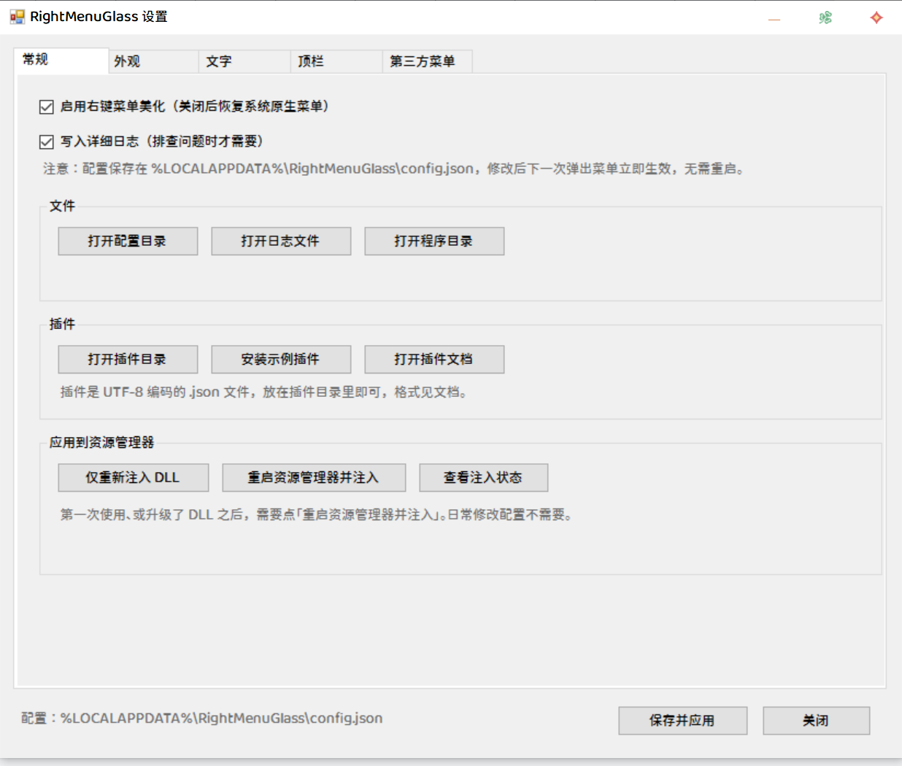
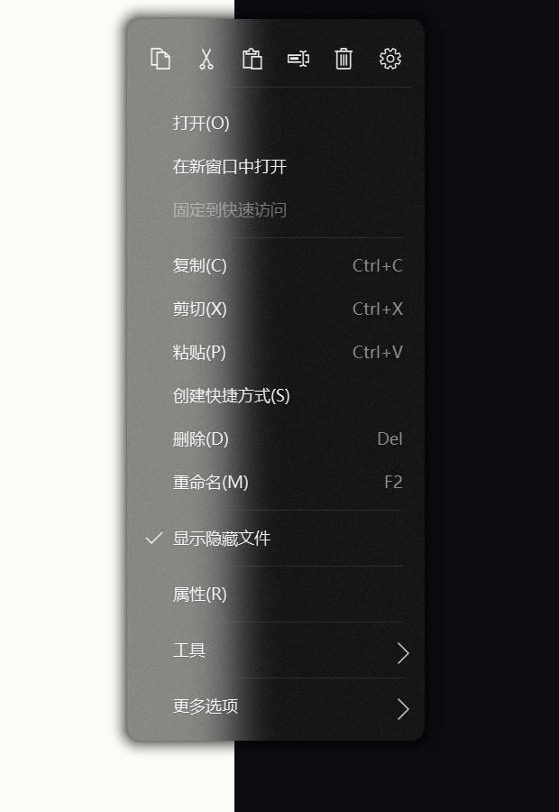
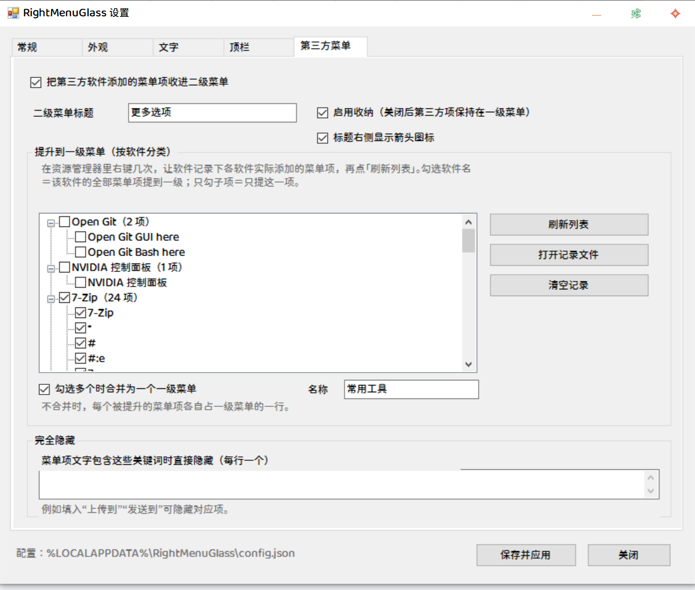

# RightMenuGlass —— Windows 资源管理器右键菜单美化

亚克力（毛玻璃）风格的右键菜单，接管资源管理器的原生右键菜单：

- **亚克力背景**：屏幕实时快照 + 降采样模糊 + 自动深浅色调，不是假透明，背景越亮菜单越浅。
- **顶栏快捷图标**：复制 / 剪切 / 粘贴 / 重命名 / 删除 / 属性等图标横向排在菜单顶部，可自定义顺序、图标、启用状态。
- **逐像素文字配色**：每个字按它正下方的背景亮度取色，同一行文字、甚至同一个笔画里都可以同时有黑字和白字；深浅两色可自定义。
- **第三方菜单收纳**：7-Zip、WinRAR、WPS、Git 之类软件添加的项自动折叠进二级菜单；设置界面按**软件**列出实测到的菜单，整组或单项都能一键提到一级菜单，勾选多个还能合并成一个子菜单。
- **插件**：用户自己写一个 JSON 文件就能给右键菜单加命令，支持条件匹配（文件类型 / 路径关键词 / 桌面 / 空白处）和变量替换。
- **自定义字体**：可选任意系统字体，也可以直接指定 .ttf/.otf/.ttc 文件。
- 所有尺寸按显示器 DPI 自动缩放。

## 目录

- [工作原理](#工作原理)
- [安装](#安装)
- [设置](#设置)
- [配置文件](#配置文件)
- [插件](#插件)
- [卸载](#卸载)
- [常见问题](#常见问题)
- [已知限制](#已知限制)

## 工作原理

Windows 的右键菜单由 `explorer.exe` 调用 `TrackPopupMenuEx` 弹出。RightMenuGlass 通过以下步骤接管：

1. `rmgctl.exe` 把 `MenuGlass.dll` 注入 `explorer.exe`（`CreateRemoteThread` + `LoadLibraryW`）。
2. DLL 修改 `user32.dll` 的导入地址表（IAT），拦截 `TrackPopupMenuEx` / `TrackPopupMenu`，并用 `LdrRegisterDllNotification` 给之后才加载的模块补丁。
3. 拦截到调用后，用 `GetMenuItemInfoW` 把 `HMENU` 读成结构化数据，创建自己的弹出窗口绘制菜单；用户选择后把结果还原成 `WM_COMMAND` 回放给窗口，或直接返回命令 ID（`TPM_RETURNCMD`）。原始 `HMENU` 因此从未被系统绘制，不存在菜单闪烁。
4. 亚克力效果：弹窗前 `BitBlt` 抓取菜单将要覆盖的屏幕区域 → 1/4 降采样 → 多次盒式模糊 → 双线性放大 → 叠加色调与噪点；窗口本身是不透明窗口，靠这张贴图和桌面无缝衔接。

## 安装

需要 Windows 10/11（x64）。

### 一键安装

下载 Release 里的 `RightMenuGlass-<版本>-win-x64.zip`，解压后**双击 `install.cmd`** 即可（它只是用 `-ExecutionPolicy Bypass` 调 `install.ps1`）。也可以在工作副本里执行：

    powershell -ExecutionPolicy Bypass -File install.ps1

脚本会：

1. 把 `bin` 里的文件复制到 `%LOCALAPPDATA%\Programs\RightMenuGlass`；
2. 写注册表 `HKCU\Software\Microsoft\Windows\CurrentVersion\Run`，让 `rmgctl.exe watch` 开机自启（它会盯着所有 explorer 进程，新开的窗口也自动注入）；
3. 重启一次资源管理器并注入，立刻生效，同时在后台启动一个 `watch` 进程，之后新开的文件夹窗口自动接管。

不需要管理员权限：所有文件都在当前用户目录，注册表项也写在 HKCU。

安装目录里：

| 文件 | 作用 |
| --- | --- |
| `MenuGlass.dll` | 注入到 explorer 的主体（钩子 + 自绘菜单） |
| `rmgctl.exe` | 注入器 / 自启动管理 |
| `rmgcfg.exe` | 图形设置界面 |
| `plugins-example\` | 4 个示例插件 |
| `docs\PLUGINS.md` | 插件编写文档 |

### 手动控制

    rmgctl.exe status        查看每个 explorer 进程是否已注入
    rmgctl.exe inject        注入所有还没注入的 explorer 进程
    rmgctl.exe uninject      从 explorer 里卸载 DLL（不重启资源管理器）
    rmgctl.exe restart       重启资源管理器并注入（升级 DLL 后用）
    rmgctl.exe restart --no-inject  重启资源管理器但不注入
    rmgctl.exe stop          结束后台的 watch 进程
    rmgctl.exe install       设置开机自启
    rmgctl.exe uninstall     取消开机自启

### 从源码构建

需要 MinGW-w64 g++（UCRT、POSIX 线程版，GCC 13+）和 .NET Framework 4.8 自带的 `csc.exe`：

    powershell -ExecutionPolicy Bypass -File build.ps1        # 生成 bin\MenuGlass.dll
    powershell -ExecutionPolicy Bypass -File build-host.ps1   # 生成 bin\rmgctl.exe
    powershell -ExecutionPolicy Bypass -File build-cfg.ps1    # 生成 bin\rmgcfg.exe

## 设置

运行 `rmgcfg.exe`。也可以把它做成顶栏按钮：在配置文件的 `buttons` 里加一项
`{ "cmd": "rmgcfg", "label": "设置", "icon": "E713", "enabled": true }`，菜单顶部就会出现一个齿轮，点一下直接打开设置界面。

- **常规**：总开关、日志开关、打开配置/插件目录、安装示例插件、重新注入。
- **外观**：模糊半径、不透明度、深浅基调色、自动过渡、噪点、圆角、阴影、内边距。
- **文字**：是否启用智能配色、浅/深背景用色、亮度分界、过渡宽度、备用色、字体与字号、行高、图标大小、菜单宽高上限、快捷键提示、勾选标记、子菜单延迟。
- **顶栏**：增删按钮、调整顺序，关键字与图标编码可编辑。
- **第三方菜单**：开关、二级菜单标题；「提升到一级菜单」按软件分组列出所有实测到的第三方菜单项，勾软件名 = 整组提到一级，勾子项 = 只提这一项，勾多个还可合并成一个子菜单；「完全隐藏」按关键词屏蔽。

配置改完点「保存并应用」，**下一次弹出菜单就生效**，不需要重启资源管理器。

## 配置文件

位置：`%LOCALAPPDATA%\RightMenuGlass\config.json`（UTF-8，可以没有 BOM）。

    {
      "version": 1,
      "enabled": true,               // 总开关，false 时完全不接管
      "logVerbose": false,           // 每次弹菜单把菜单项写进 dll.log（排查用）
      "colors": {
        "enabled": true,
        "perPixel": true,            // true = 逐像素判断（一个字可以多色）
        "darkText": "#000000",       // 浅背景上用的颜色
        "lightText": "#FFFFFF",      // 深背景上用的颜色
        "threshold": 140,            // 0-255，亮度分界
        "softness": 18,              // 过渡带总宽度（像素），默认约一个汉字宽，0 = 黑白硬切换
        "extraDark": "",             // 备用色，留空不用
        "extraLight": ""
      },
      "acrylic": {
        "enabled": true,
        "blurRadius": 18,            // 模糊半径（像素）
        "opacity": 58,               // 0-100，色调叠加强度
        "tint": "#202020",           // 深色基调
        "autoTint": true,            // 按背景亮度在 tint / lightTint 之间过渡
        "lightTint": "#F3F3F5",      // 浅色基调
        "noise": 5,                  // 0-40 磨砂颗粒
        "corner": 10,                // 圆角
        "shadow": 14,                // 阴影
        "margin": 10                 // 内边距
      },
      "style": {
        "fontFamily": "Microsoft YaHei UI",
        "fontFile": "",              // 可选：.ttf/.otf/.ttc 绝对路径，优先于 fontFamily
        "fontSize": 9,               // 磅
        "itemHeight": 32,            // 行高
        "iconSize": 16,
        "minWidth": 180,
        "maxWidth": 520,
        "maxHeight": 720,
        "showShortcut": true,        // 显示 Ctrl+C 之类的提示
        "showCheckmarks": true,      // 显示 ✓
        "hoverDelayMs": 320          // 悬停多久展开子菜单
      },
      "thirdParty": {
        "enabled": true,
        "title": "更多选项",          // 二级菜单标题
        "submenu": true,             // false = 第三方项留在一级菜单
        "submenuTitleIcon": true,
        "promoteGroups": [           // 整组提到一级菜单（在设置界面勾选软件名生成）
          { "id": "grp:00b5399818201f72", "name": "7-Zip", "all": true }
        ],
        "promoteItems": [            // 只提某一项（勾选子项生成）
          { "id": "grp:00b5399818201f72", "item": "7-Zip" }
        ],
        "mergePromoted": true,       // 提到一级的项多于一个时，合并成一个子菜单
        "mergedTitle": "常用工具",    // 上面那个子菜单的标题
        "keepTop": [],               // 关键词，命中就留在一级菜单（旧方式，仍可用）
        "hide": []                   // 关键词，命中就彻底不显示
      },
      "buttons": [                   // 顶栏按钮，顺序即显示顺序
        { "cmd": "copy",   "label": "复制",   "icon": "E8C8", "enabled": true },
        { "cmd": "cut",    "label": "剪切",   "icon": "E8C6", "enabled": true },
        { "cmd": "paste",  "label": "粘贴",   "icon": "E77F", "enabled": true },
        { "cmd": "rename", "label": "重命名", "icon": "E8AC", "enabled": true },
        { "cmd": "delete", "label": "删除",   "icon": "E74D", "enabled": true },
        { "cmd": "props",  "label": "属性",   "icon": "E713", "enabled": true }
      ]
    }

`buttons` 的 `icon` 可以是：

- 4 位十六进制字符编码（Segoe MDL2 Assets 字形，如 `E8C8`）；
- 直接写一个字符（比如 `★`）；
- JSON 里也可以写 `\uE8C8`。

`cmd` 支持的关键字：`copy` `cut` `paste` `rename` `delete` `props` `refresh` `new` `open` `settings` `share` `more`，以及特殊值 `rmgcfg`（打开设置界面，永远可用）。其余关键字命中不了任何菜单项时该按钮自动变灰。

## 插件

把 JSON 文件放进 `%LOCALAPPDATA%\RightMenuGlass\plugins\`，下一次弹菜单就会加载。完整格式、字段说明、变量表、7 个示例见 [docs/PLUGINS.md](docs/PLUGINS.md)。

最小例子：

    {
      "name": "我的工具",
      "group": "工具",
      "match": { "contexts": ["files"], "extensions": [".png", ".jpg"] },
      "items": [
        { "text": "用画图打开", "command": "mspaint.exe \"%1\"" }
      ]
    }

## 卸载

    powershell -ExecutionPolicy Bypass -File uninstall.ps1

或手动：

1. `rmgctl.exe uninstall`（删自启）；
2. `rmgctl.exe stop`（结束后台 watch 进程）；
3. `rmgctl.exe uninject`（从 explorer 卸载 DLL；它会把被打补丁的导入表恢复原样）或者 `rmgctl.exe restart --no-inject`；
4. 删除安装目录和 `%LOCALAPPDATA%\RightMenuGlass`。

## 常见问题

**菜单没变化？**
先看 `rmgctl.exe status`。Win10 的资源管理器可能同时开着好几个 explorer 进程（每个文件夹窗口一个），全部 `loaded=1` 才会生效。刚安装完点一次「重启资源管理器并注入」最稳。

**菜单闪一下就消失 / 资源管理器崩溃？**
先 `rmgctl.exe uninject`，再用设置界面把 `enabled` 关掉。崩溃日志见 `%LOCALAPPDATA%\RightMenuGlass\dll.log`。

**杀毒软件报警？**
注入 explorer + IAT 补丁是典型的"可疑行为"，需要把安装目录加白名单。这是自绘菜单绕不开的技术路线。

**右键菜单里的图标怎么换？**
用 [Segoe MDL2 Assets 字符表](https://learn.microsoft.com/windows/apps/design/style/segoe-ui-symbol-font) 的 4 位编码，或任意普通字符。

**第三方菜单分类不准？**
判断分两层：先看一张"只属于系统菜单"的硬性词表（打开、发送到、剪切、新建、查看、排序方式、属性……），命中就留在一级菜单；剩下的再看厂商关键词和"不像系统项"这条兜底规则。这只是决定"进不进二级菜单"。

**想让某个软件的菜单直接出现在一级菜单？**
打开设置 → 第三方菜单页，上面那张树状列表就是软件实际添加过的菜单项，按软件分组（7-Zip、WPS、Git……）。勾**软件名** = 该软件的所有菜单项提到一级；展开后勾**某一项** = 只提这一项；勾了多个时再勾上「合并为一个一级菜单」，它们会装进一个自定义标题的子菜单（默认「常用工具」）。

列表是软件**实际见过**的菜单项，全新安装时是空的：先在资源管理器里对文件、文件夹空白处、桌面分别右键几次，再点「刷新列表」。
分组按"菜单项文字的共同前缀"归并，个别软件可能拆成两组（比如 7-Zip 的「全部解压缩」和「7-Zip」），勾选时手动一起勾上即可。想彻底隐藏某项，用下面的「完全隐藏」关键词。

## 已知限制

- 只接管 **资源管理器**（桌面、文件夹窗口、任务栏）的右键菜单；浏览器、Office 等自己实现菜单的程序不受影响。
- 以管理员身份运行的程序（explorer 以普通权限运行，无法注入提权进程）里的菜单不会被接管。
- 第三方菜单的"第三方"判断是启发式的（关键词 + 是否系统常见项），个别软件可能归错类。
- 按软件分组靠菜单项文字的共同前缀聚类，同一软件若使用了差异很大的措辞（如 7-Zip 的「全部解压缩(T)」与「7-Zip」），会被拆成两组，需要在设置里手动一起勾选。
- 亚克力是"屏幕快照 + 模糊"，不是 DWM 实时背景；菜单里如果有动画内容（视频壁纸），静止时快照不会刷新。

## 更新记录

**2026-11-14**

- 修复：菜单弹出后，在菜单外面点鼠标没反应、只能按 ESC 关闭的问题。原因是菜单窗口握着鼠标捕获，外部点击被自己吞掉了；现在只要点击位置不落在任何一层菜单窗口内，整条菜单链立即关闭。
- 修复：菜单弹出时若鼠标正停在带子菜单的项上，会莫名自己展开子菜单（现在必须真的移动过鼠标才会触发悬停展开）。
- 修复：按 ESC 只关掉子菜单、主菜单留着（现在一次性关闭整条菜单链，和系统菜单一致）。
- 新增：点击任务栏、点击别的程序窗口、点击桌面空白处等任何菜单外面的位置，都会立即关闭整条菜单链。
- 修复：鼠标扫过一级菜单时，已经弹出的二级菜单会"粘"在原处不跟着收起。现在鼠标离开那一行（或该行不再有子菜单）时，旧的二级菜单立即折叠，并自动跟随到鼠标真正所在的那一层菜单上处理，斜向滑进子菜单也不会被误关。
- 修复：鼠标从菜单里滑到桌面后，原本应只收起二级菜单、保留主菜单，实际却把整条菜单链一起关掉了（折叠子菜单时它把焦点一起带走了）。现在离开整条菜单链只折叠二级菜单，主菜单留在原地，移回来还能继续操作。
- 新增：文字颜色在深浅交界处不再从黑直接跳成白，而是平滑过渡。取色改看"周围一小块背景的平均亮度"（半径由「文字 → 过渡宽度」决定），所以即使背景是一条硬边（窗口边缘、截图切线），跨过去的笔画也会从黑慢慢变白，而不是在某一列突然断开。设成 0 就回到原来的硬切换。（过渡宽度默认已调整为 6，配合下面的描边光晕。）
- 新增：菜单会根据呼出位置自动调整，向屏幕中央靠拢。在主菜单靠近屏幕边缘时不再紧贴边框或被裁切，而是沿溢出方向平移到可见区域内，并再往中间挪一小段距离；子菜单仍然贴着父项展开，只有两侧都放不下时才居中。
- 新增：文字"描边光晕"。在笔画外侧一圈加与文字相反的颜色（白字加深色描边、黑字加浅色描边），半透明、只覆盖非文字像素。这样即使背景是花哨的壁纸或深浅交错的照片，字也能一直看清；过渡宽度默认从 18 降到 6，兼顾美观与可读性。设置界面「文字」页可调描边宽度（0–3 像素）与描边强度（0–100）。
- 新增：设置界面的字体跟随右键菜单设置（`style.fontFamily` / `style.fontFile` / `style.fontSize`），换字体或字号后设置窗口本身的文字也一起变。
- 修复：第三方菜单收纳不一致。新增"硬性系统词表"后，`通过WPS发送`、`Open Git GUI here` 这类带着厂商名却因为措辞不同而漏掉的项，现在都会进二级菜单；反过来，`发送到(N)`、`打开方式(H)` 这类系统项不会再被误收进「更多选项」。
- 新增：第三方菜单**按软件分组**。软件会记录实际出现过的第三方菜单项，以顶层菜单项为单位按文字共同前缀聚类（系统菜单的子树不参与），在设置界面「第三方菜单 → 提升到一级菜单」里以树状列出：勾软件名即整组提到一级，展开后勾子项即只提这一项，勾选多个时可合并为一个自定义标题的子菜单（默认「常用工具」）。记录存于 `%LOCALAPPDATA%\RightMenuGlass\observed.json`。
- 改进：描边光晕随对比度自适应。背景亮度越接近「亮度分界」越需要描边，远离分界时描边自动减弱到几乎不可见 —— 白纸黑字不再发糊，而深色壁纸上的白字依然有描边托底。

